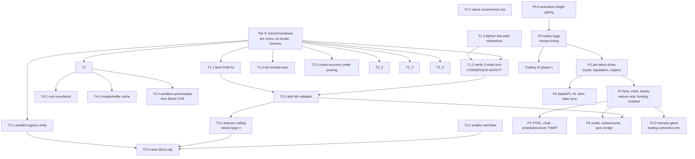

# Torus-hyperBFT — Performance, Correctness & Product Roadmap to Hyperliquid Parity

**Author:** architecture review synthesis
**Status:** proposal for sequencing — not yet accepted (July text). **s131 (2026-10-20):** every item carries a dated **Status s131** line from a status audit against main `be87c86e` (owner-approved); see "Status summary (s131)" below. The original reasoning is kept; text that later work overtook is marked "(July text, superseded)".
**Companion docs:** `Torus-hyperBFT-review.md` (full architecture + critical findings) · `reports/hl-parity-2026-10-01/` (product-parity sprint: 220-agent gap analysis behind the Product-parity track)

---

## 0. How to read this document

This is a single-file roadmap **plus** the detailed work packages ("PRPs" — Problem / Rationale / Plan) for each item. It is ordered so that **each tier is a prerequisite for the next**: you cannot trust a throughput number measured on a wedging chain, and you cannot trust a wedge fix measured on a starved CPU. The ordering is the deliverable — the individual ideas were already known to the project; what was missing is *which to do first and why*.

**Target (from the project's own goals + Hyperliquid's published numbers):**
- Blockspeed: ~289ms → ~70–100ms median time-to-commit
- Orders/s: ~11–35k measured → 200k end-to-end committed
- EVM: sustained throughput without state-root growth stalls

**Design stance for every item below — "best implementation quality" means:**
1. **Correctness is gated by a test that fails first (RED) and a determinism/oracle check that runs in CI**, not by a benchmark that looks good once.
2. **Every consensus-affecting change is either provably safe (written argument + model check) or explicitly proven to be node-local (cannot fork the chain).** We label each item **[LOCAL]** (proposer/node-local, cannot cause divergence), **[LOCKSTEP]** (changes the verify/consensus format — all validators must upgrade together), or **[CONSENSUS-SAFETY]** (touches the safety argument itself — requires proof before merge).
3. **No silent caps or truncation.** Any bound that drops work emits a metric.
4. **Measurement is done on isolated hardware** before any code conclusion is drawn (see Tier 0).
5. **One change per PR, each independently revertible**, behind a flag where the blast radius is the whole fleet.
6. **A change to a stored borsh layout needs a migration or a fresh genesis.** Since row 74 (`item6-phase1-impl.md`), a stored row that does not decode is a local fault: the node fail-stops at the first read. Rows written before the change (example: `ValidatorState` has no fallback for rows without `oracle_signer`) would halt every node at once. Before row 74 the step only returned an error.

---

## Status summary (s131, 2026-10-20; audited against main `be87c86e`)

Tiers 1-4 are mostly done: T1.1-T1.6, T2.1-T2.4, T3.2, T4.1-T4.3 and the T4.4 journaling all landed between June and October (SHAs in each item). T1.2 was answered: the grandparent lock was **unsafe** for the 2-chain commit and was changed to lock-on-parent. Still open: T0.2 (co-location), T3.1 beyond recovery Phase A, Block-STM (T4.4, deferred by design), Tier 5, and most of the product-parity track (P2-P5).

**Open before the testnet** (one line each, with where it is tracked):
- **Validator count (T1.4 vs trial testnet):** T1.4 set f=1 (4 validators) as the minimum, but the planned trial testnet runs 3 validators (f=0). Owner s131: deferred to one of the last pre-trial decisions; it blocks nothing (4-validator support exists since July). Tracked in T1.4 and in "Trial testnet" under Pre-testnet decisions.
- **Unknown market ids still create books in the executor (P0):** RPC rejects them, consensus does not. In progress on `fix/pretestnet-p0-p1` (s131).
- **Block timestamp lower bound (P0, review M2):** in progress on `fix/pretestnet-p0-p1` (s131).
- **Governance Delist / UpdateMarketParams have no executor effect (P1):** in progress on `fix/pretestnet-p0-p1` (s131).
- **P0.0 activation-height gating:** not started; only `state_hash_activation_height` exists. Tracked in P0.0.
- **Liquidator-vault deficit (P5):** monitoring is done. Owner s131 (as decided s99): for the testnet, seed the liquidator vault with capital in the genesis, with ADL as the backstop once the vault runs dry; an HLP-style deposit vault before mainnet. Still open: the seed amount. Tracked in P5.
- **Aliased opaque position rows in the parallel settle:** answered s132 (they cannot exist on a fresh genesis); reject-on-load fix on `fix/aliased-rows-reject` (2026-10-21), not merged yet. Tracked in Pre-testnet decisions.
- **EVM proposer concentration (Q12):** decided s131: keep N = 11 for the testnet (coprime to 3 / 4 validators); revisit before mainnet. Tracked in Pre-testnet decisions.
- **Retention default (prune by default or not):** decided s131: prune by default, N = 100,000 blocks, archive nodes opt out with `--archive` (RH4 GC worker + compaction filter merged, perf doc sections 103 and 112). Still open: which testnet node runs as the archive node; revisit N if the trial testnet's catch-up or disk numbers say so. Tracked in Pre-testnet decisions.
- **Book storage mode for the genesis (Classic vs mode 3):** bench 8p / 8s and owner decision. The mode is now a genesis field (s131, `feat/book-mode-genesis`): `consensus.book_mode`, absent = Classic, `"level_authority_chunked"` = mode 3; the node refuses a disagreeing `TORUS_BOOK_ROWS` or DB marker. What is left is the value. Tracked in Pre-testnet decisions and `docs/perf/bench-queue.md`.
- **Running state hash in the genesis:** whether the testnet genesis sets `consensus.state_hash_activation_height` (absent = running hash off; `docs/plans/running-state-hash-impl.md`). Owner decision before the genesis.
- **WAN measurements:** PE on WAN, push-manifest threshold, header re-send and the T2.5 cap of 400 were all measured on one host only. The trial testnet doubles as the WAN test. Tracked in Pre-testnet decisions.

---

## Tier 0 — Measure on honest hardware *(do before touching any code)*

> **Why first:** The project's own `ingress-cpu-supply.md` analysis is the most important finding in the entire performance history: the real per-action crypto cost is **~5.8ms**, but live runs measured ~70ms — a 12× inflation caused by **CPU starvation from co-resident processes** (a 100%-pinned MCP gateway, concurrent dev sessions) on a load-11 shared box. On paper there is already **~345k orders/s of ingress headroom**. Simultaneously, blockspeed is purely **RTT-bound** — there is no pacing floor in the code, so the 227–502ms inter-validator legs are pure geography. **A large fraction of the apparent gap is not in the code.** Any engineering done before isolating the environment optimizes against noise.

### T0.1 — Dedicated, pinned validator hardware [LOCAL]
- **Status s131: PARTLY.** Benches run on a dedicated rig (archy), but all 3 validators share one host, so it is not one box per validator and the per-validator RTT is loopback.
- **Problem:** Benchmarks run on shared boxes with load ~11 from non-chain processes; verify/exec timings are contention-dominated.
- **Plan:** Provision one dedicated box per validator. Pin the node to isolated cores (`cpuset`/`taskset` — the runbook already exists, `ingress-cpu-supply.md` B1, and was never applied). Reserve cores for: consensus algorithm thread, execution thread, ingress rayon pool, libp2p. Move the MCP gateway / dev tooling off the validator boxes entirely.
- **Acceptance:** Re-run the bs100 / bs500 sweeps; `rpc_submit_verify_cpu_seconds` should approach the ~5.8ms/action floor with p99 within 2× of median (today it's 10×+). **No code merged in any later tier is measured until this passes.**
- **Effort:** ops, days. **Risk:** none. **Impact:** likely the single largest measured orders/s gain in the whole roadmap.

### T0.2 — Co-locate validators to cut RTT [LOCAL]
- **Status s131: OPEN.** The planned trial testnet (Pre-testnet decisions) goes the other way on purpose: two home validators plus 18c over the WAN, to measure the WAN cost.
- **Problem:** ~70ms Hyperliquid blocks imply tightly-placed validators; Torus legs are 227–502ms.
- **Plan:** Place the validator set in one region (or a small set of low-RTT regions), as Hyperliquid does (Tokyo-centric). Keep archive/RPC nodes wherever users are.
- **Acceptance:** Measured inter-validator RTT < 50ms; empty-block cadence approaches the ~102ms local floor observed in S395.
- **Effort:** ops. **Risk:** centralization tradeoff (document it). **Impact:** this is what stands between ~289ms and ~70–100ms — it is physics, not code.

### T0.3 — Trustworthy measurement harness [LOCAL]
- **Status s131: PARTLY.** matched-bench scores cadence as a slope over the load window (`d9512362`) and `quiet()` gates on a 5 s CPU busy sample (`43179dc5`). The trading-semantics mix is partial: liquidation stress cells exist (perf doc `docs/perf/ozarchy-antispam-item6-pf1-2026-10-04.md` section 72), stops, modifies and funding are not in the standard mix.
- **Problem:** Historical benches conflated endpoint-to-endpoint timing with committed cadence; the project already adopted a "least-squares slope over height samples, never endpoint-to-endpoint" rule (S405) — codify it.
- **Plan:** A single benchmark script that (a) pre-signs all actions before the measurement window, (b) reports committed-orders/s from chain state (not submit acks), (c) reports the dup-inclusion factor, (d) reports p50/p99 view duration by slope fit, (e) records the box's load average alongside every run and **refuses to report if load > 1.0 on a validator core**.
- **Acceptance:** Two back-to-back runs agree within 5%.
- **Effort:** small. **Risk:** none. **Impact:** every number in Tiers 1–4 depends on it.

---

## Tier 1 — Liveness & correctness *(a fast chain that wedges has zero throughput)*

> **Why second:** Under order-flood the chain currently has documented failure modes — the "body-miss death spiral," the epoch-boundary halt, and a consensus-safety question at the exact point where you'd add fault tolerance. Every throughput number in Tiers 2–4 is only meaningful if the chain stays live under that load. These are also the items where a mistake is *unrecoverable* (a fork or a permanent halt), so they get the most rigor.

### T1.1 — Land the S430 body-starvation fix (remove the diagnostic kill-switch) [LOCAL]
- **Status s131: DONE** `2e340938` (proactive fetch of missing bodies, S432). No `TEMP-DIAGNOSTIC` guard is left in the code.
- **Problem (July text, superseded):** The working tree's `request_missing_parent` (the fix for the header-first body-starvation livelock) is **disabled** by a guard marked `// TEMP-DIAGNOSTIC (S430 A/B): ... REMOVE`:
  ```rust
  if justify_view.int() != u64::MAX { return; }   // never false → fix is a no-op
  ```
  A body-starved validator that becomes leader burns a full view timeout on every leader slot (~84% failure under 8-way load in `parent_body_starvation_test`).
- **Rationale:** This is node-local (it only *adds* a by-hash parent fetch; it changes no wire format or vote). Pure liveness win, zero safety cost.
- **Plan:**
  1. Confirm what the A/B was isolating (read the S430 commit trail; the guard was added to bisect a regression — establish that regression is understood/resolved).
  2. Remove the guard.
  3. Keep the fetch-storm suppression that's already in the fix (don't re-fetch when the body is already parked in `deferred_bodies`).
- **Acceptance (RED-first):** `parent_body_starvation_test` fails with the guard present (starves within its 30s window), passes with it removed. `progress_and_validator_set_update` failure rate under 8-way load drops from ~84% to near 0. Zero `rc=134` (assert aborts).
- **Effort:** trivial code, careful verification. **Risk:** low. **Impact:** removes the worst load-induced stall. **Do this first in Tier 1.**

### T1.2 — Settle the 2-chain lock-depth question before growing the validator set [CONSENSUS-SAFETY]
- **Status s131: DONE.** The model found the grandparent lock **UNSAFE** for the 2-chain commit (`0923812d`), so the "If it breaks" branch of the plan was taken: `pc_to_lock` now locks on the parent (`4a94e8bc`), and the stateright model runs with `PRODUCTION = Parent` (`f6fac872`; `specs/consensus/stateright_2chain_safety.md`). The CONS-CHK-14 line in `research/audit-scope.md` was updated in s131. The MonadBFT framing below is July text, superseded.
- **Problem (July text, superseded by the finding above):** Torus forked the **3-chain** `hotstuff_rs`, cut the *commit* rule to 2-chain (`block_to_commit`, invariants.rs:518), but left the **3-chain grandparent lock** in place (`pc_to_lock(Generic) = justify.block.justify`, invariants.rs:434; `extends_locked_pc_block` checks to grandparent depth, invariants.rs:631). Production 2-chain protocols (HotStuff-2, Jolteon) lock **on the parent**. The project's own `specs/consensus/safety_arguments.md:207–233` reaches this exact spot and writes *"The formal gap here is whether an honest validator can commit C before seeing B's 2-chain. This is possible in async networks"* — then **defers to the MonadBFT paper** rather than closing it. This is **moot at today's 3-of-3 quorum (f=0)** but becomes load-bearing the moment a 4th validator makes f=1 — which is exactly the plan.
- **Rationale:** Two conflicting blocks committing is the worst possible bug (a fork). We do not want to discover the answer in production. This is not "the code is wrong" — MonadBFT (arXiv:2502.20692 Thm 1) claims lock-on-grandparent *is* sufficient for 2-chain; the question is whether *this implementation* faithfully matches that proof's locking depth and consecutive-views constraints.
- **Plan:**
  1. **Model-check it.** Write a Stateright (Rust, native to this codebase) or TLA+ model of exactly this protocol: 2-chain consecutive-views commit + grandparent lock + `safe_pc` predicate 3 + the header-first `safe_pc` relaxations (see T1.3). Drive n=4 (f=1) with an equivocating leader + partition/heal. Assert agreement (no two conflicting blocks committed) and check to a bounded depth.
  2. **If it holds:** capture the invariant the model relied on, write it as a `debug_assert` at the commit site, and document the mapping to MonadBFT Thm 1. Update `audit-scope.md` CONS-CHK-14 (which still says "chain of 3 certified blocks" — stale) to check *lock-depth-vs-commit-depth consistency*, the thing neither the checklist nor the 3.4.2 pass-note actually verified.
  3. **If it breaks:** change `pc_to_lock(Generic)` to lock on `justify` (lock-on-parent) and re-check. **Do not** re-add the third chain — that sacrifices the ~1-RTT finality latency the whole system is built around; lock-on-parent fixes it at zero latency cost.
- **Acceptance:** A model-checked agreement proof to bounded depth for n=4, committed to `specs/consensus/`, **before** T1.4 (4th validator) merges.
- **Effort:** medium-high (1–2 weeks for a careful model). **Risk of skipping:** catastrophic. **Impact:** unblocks fault tolerance safely.

### T1.3 — Tighten the header-first fast-path relaxations [CONSENSUS-SAFETY]
- **Status s131: DONE.** Lock-before-vote on the header fast path and a view-monotonic lock (`2f196f9c`); a vote only once the body is held (`973cc747`, s84 option A). All three relaxations are in the model (`specs/consensus/stateright_2chain_safety.md`, "Header-first relaxations (all modeled)").
- **Problem:** The hybrid-pipelining path weakens three classical invariants (all confirmed in code): (a) replicas **vote before `app.validate_block`** runs (validation is deferred to body arrival); (b) `on_receive_proposal_header` **skips `safe_pc`** when the justify's block is already tracked as pending (implementation.rs:1653–1667); (c) **block-sync commits skip `safe_block`/`safe_pc`** entirely (client.rs:258–311), trusting "a valid QC chain is globally unique" — which is exactly the property T1.2 questions.
- **Rationale:** Each relaxation is individually defensible for liveness/latency, but they compound with T1.2 and with each other. They must be *in the model* of T1.2, not reasoned about informally.
- **Plan:**
  1. Include all three relaxations in the T1.2 model (they change the reachable state space).
  2. For (c) specifically: since sync trust depends on QC-chain uniqueness, and that's the crux of T1.2, make the sync-commit path's safety **explicitly conditional on the T1.2 outcome** — if the model needs lock-on-parent, the sync path inherits it.
  3. Add a metric for "voted on header later found app-invalid" so the vote-before-validate window's real-world frequency is observable.
- **Acceptance:** No relaxation is outside the checked model; the app-invalid-vote metric is wired.
- **Effort:** folds into T1.2. **Risk:** these are the areas where the recent livelocks surfaced — treat with care.

### T1.4 — Add a 4th validator (fault tolerance + fix the epoch halt trap) [LOCKSTEP]
- **Status s131: DONE in July,** with a conflict now pending. A 4-validator testnet genesis landed in `1b4c3b9f` (f=1, after the wrong-set-PC fix `771b063`), and a replica restarted inside an uncertified epoch-change view rejoins (`d995f68a`). **Conflict:** the planned trial testnet (Pre-testnet decisions) runs 3 validators (f=0), which goes against this item's f=1 minimum. **Owner s131:** deferred to one of the last decisions before the trial; it blocks nothing (4-validator support exists since July).
- **Problem:** 3-of-3 quorum has **zero fault tolerance** (any node down = halt), and there's a documented **epoch-boundary quorum off-by-one**: with 3 equal stakes, epoch-change views need a quorum greater than any two validators, so the chain mechanically halts within ~100 views (one epoch) of losing any validator. The project's notes carry a standing rule: *do not change the validator set on the fleet-pinned binary* until the wrong-set-PC fix (771b063) ships.
- **Rationale:** f=1 is the minimum credible BFT posture. But this is the exact transition T1.2 must clear first.
- **Plan:** Gate on T1.2 (safety) and T1.1 (liveness) landing. Ship the wrong-set-PC fix to the whole fleet in lockstep. Add the 4th validator. Re-verify the epoch-boundary quorum math with n=4.
- **Acceptance:** Chain survives a single-validator kill+restart across an epoch boundary; no halt.
- **Effort:** ops + lockstep deploy. **Risk:** the ordering (must follow T1.2) is the whole point.

### T1.5 — Kill the zombie-execution failure mode [LOCAL]
- **Status s131: DONE.** Fail-stop watcher (`e63dcb70`, `6f09ec3a`), execution crash-safety (`c0fd7c11`), replay stops at a fail-stop (`3b93d3df`), fail-stop on every failed serial state write (`01d991ab`, audit R01).
- **Problem:** A panic in one market's matching thread (`market_workers.rs:77`, `h.join().expect("market worker panicked")`) kills the execution thread; consensus then keeps advancing height while every commit logs "execution pipeline channel closed — block will not be executed!" (app.rs:2071). **Height advances, state freezes** — the worst silent failure for a chain. Pervasive `.lock().unwrap()` on swarm/mempool paths makes lock-poisoning a realistic trigger.
- **Plan:**
  1. Catch per-market worker panics, convert to a typed error, and make the execution thread's death **halt consensus** (fail-stop) rather than let it zombie-advance. A node that cannot execute must stop producing/voting, not finalize un-executable blocks.
  2. Audit the `.unwrap()` on locks in the swarm loop and execution path; convert poisonings to fail-stop with a clear log, not silent thread death.
- **Acceptance:** Injected matching-engine panic causes a clean node halt with a diagnostic, **not** a height-advancing/state-frozen node. A test that poisons a market worker asserts the node stops finalizing.
- **Effort:** small-medium. **Risk:** low. **Impact:** converts a silent chain-corruption mode into a loud, recoverable crash.

### T1.6 — Fix the latent crash-recovery skip under pruning [LOCAL]
- **Status s131: DONE.** `find_last_committed_height` hardened (`6f09ec3a`); crash-injection harness `87a7b570`.
- **Problem:** `find_last_committed_height` (app.rs:156) reads only the last key of `cf_block_headers`, but the pruner stores its progress meta key in the **same CF** (pruner.rs:78) and it sorts after all realistic height keys — so once pruning has run, the function returns `None` and crash-recovery replay (app.rs:1169) is silently skipped.
- **Plan:** Move the pruner meta key to `cf_consensus_meta` (or any CF not scanned for max-height), or make `find_last_committed_height` explicitly skip non-height keys. Add a crash-recovery test **with pruning enabled**.
- **Acceptance:** Kill a pruning node mid-block; on restart it replays the gap correctly (today it doesn't).
- **Effort:** small. **Risk:** low. **Impact:** correctness under the default archive-off config.

---

## Tier 2 — Orders/s: raise the ceiling toward 20k orders/block

> **Why third:** 200k orders/s ÷ ~10 blk/s = **20k orders/block**. The batching keystone (O2, `PlaceOrderBatch` — one ecrecover per 1024 orders) already shipped and gave ~38× (293 → 11.2k orders/s). The remaining ceiling is set by (a) a serial ingress verifier, (b) a conservative block cap that's coupled to (c) body dissemination bandwidth. These are ordered so the cap is only raised once dissemination can carry it — otherwise you re-create the historical bs1000 wedge.

### T2.1 — Parallelize gossip-ingest signature verification [LOCAL]
- **Status s131: DONE** `dd7457e5` (gossip verification on the dedicated `torus-gossip-verify` pool).
- **Problem:** `add_native_action_from_gossip` (main.rs:513 → mempool lib.rs:385) runs **one serial ecrecover per action on a single tokio task** on the consensus/libp2p runtime — a hard **~10k action/s single-core ceiling** per validator, and it competes with consensus.
- **Rationale:** Node-local, and the safety backstop already exists: the exec thread re-verifies every signature post-commit and **slashes+tombstones** the proposer on any invalid sig (app.rs:337). So ingress can afford to be optimistic.
- **Plan:**
  1. Route gossip-ingest verification through the **dedicated ingress rayon pool** (the one already sized `cores/2` and isolated to avoid starving consensus — `ingress-verify-fix` proved a *shared* pool regresses, block time 529→4034ms; a dedicated pool is the fix).
  2. Batch-verify (ed25519 batch API for session keys; parallel secp256k1 recover for EIP-712).
  3. Dedup against the verified-sender trust cache **before** recovering.
- **Acceptance:** Gossip-ingest verify throughput scales with the ingress pool's core count; consensus view duration under flood does not regress (this is the trap from `ingress-verify-fix` s352 — the acceptance test must assert no consensus starvation). Slashing test still fires on an injected bad sig.
- **Effort:** medium. **Risk:** medium (the starvation trap is real — hence the dedicated-pool requirement and the explicit no-regress gate). **Impact:** removes the per-node ingest wall.

### T2.2 — Batch the per-action DA write on ingress [LOCAL]
- **Status s131: DONE** `dd7457e5`: the ingress DA mirror flushes at 128 bodies or 50 ms (`DA_MIRROR_BATCH_MAX` / `DA_MIRROR_MAX_AGE`, `crates/torus-mempool/src/lib.rs`).
- **Problem:** `mirror_to_da` (mempool lib.rs:604) does one RocksDB `put` **per action on the RPC ingress path**. The proposer path already batches into one `WriteBatch`; ingress didn't get the same treatment.
- **Plan:** Accumulate ingress DA mirrors over a ~50ms window (or N actions) into a single `WriteBatch`, matching the proposer path.
- **Acceptance:** RocksDB write ops/action on ingress drop ~N×; no increase in body-miss rate (bodies still durable before the action can be selected).
- **Effort:** small. **Risk:** low. **Impact:** removes ingress write amplification.

### T2.3 — Incremental native-pool ordering [LOCAL]
- **Status s131: DONE** `dd7457e5`: the pool's selection order is a `BTreeMap` maintained at insert / remove (`crates/torus-mempool/src/native_pool.rs`; the key later gained the oracle priority class).
- **Problem:** `select_native_for_block` sorts the **entire** native pool (≤65,536 entries) and rebuilds the hash index **on every `produce_block`**, under the pool write lock, contending with RPC/gossip inserts (native_pool.rs:283–295).
- **Plan:** Maintain a sorted index incrementally (a `BTreeMap` keyed by `(is_cancel, sender, nonce)`), so selection is a bounded scan, not a full re-sort. Take a snapshot to select outside the write lock.
- **Acceptance:** `block_build_seconds` no longer grows with pool depth; ingress insert latency under load drops (no longer blocked behind a full sort).
- **Effort:** medium. **Risk:** low (proposer-local; determinism gate: same selection as the sort-based version for identical pool state). **Impact:** removes a proposer-critical-path O(n log n) and a lock-contention hotspot.

### T2.4 — Eliminate the canonical-identity re-serialization tax [LOCKSTEP-sensitive]
- **Status s131: DONE at RPC ingress** `dd7457e5` (hash computed once on the shared verify path, `crates/torus-rpc/src/torus.rs` ~1622). "Computed exactly once end-to-end" (the acceptance below) is not proven.
- **Problem:** Even the binary ingress endpoint re-serializes each action to **serde_json** to compute the keccak action-hash (torus.rs:298), because the action-identity is *defined* as keccak of canonical serde_json bytes. That definition is consensus-critical (all nodes must agree on the hash), so it can't be changed casually.
- **Plan:** Cache the canonical bytes alongside the action from the moment it's first decoded, so the hash is computed once and the bytes are reused for DA/gossip/forward rather than re-serialized at each hop. **Do not** change the hash definition (that's a lockstep chain-format change with a migration); just stop recomputing it.
- **Acceptance:** Action-hash is computed exactly once per action end-to-end; a determinism test confirms the cached-bytes hash is byte-identical to the recomputed one across every path (this is the existing `bincode_roundtrip_preserves_action_hash`-style gate, extended).
- **Effort:** medium. **Risk:** medium (touches the identity path — the determinism gate is mandatory). **Impact:** cuts CPU and allocation on the hottest ingress path.

### T2.5 — Raise `NATIVE_TOTAL_BLOCK_CAP` toward 20k-orders/block — *gated on T3.1* [LOCAL]
- **Status s131: SUPERSEDED.** The cap went 100 -> 200 -> 400 (`7bcc179a`, s76) **without** T3.1, on loopback benches only; the cap of 400 is unproven on a WAN (trial testnet). The `VERIFIED_SENDER_CACHE_CAP` note in the plan is obsolete: the cache now scales with the block cap (`crates/torus-mempool/src/rate_limit.rs`, with 16,384 as the floor).
- **Problem (July text, superseded):** `NATIVE_TOTAL_BLOCK_CAP = 100` actions/block. With max batches (1024 orders each) that's already 102k order-slots, but the **byte cap** (6MB ≈ 40k orders) and **dissemination** are the real limits. The cap is deliberately conservative — it's the WAN dissemination guard, and raising it alone re-creates the historical bs1000 wedge.
- **Rationale:** This is a knob, not code — but it's the knob that turns dissemination capacity into orders/s. It must move *with* T3.1 (erasure coding), never ahead of it.
- **Plan:** After T3.1 lands, sweep the cap upward on devnet with the T0.3 harness, watching the body-miss rate and view-duration p99. Move `VERIFIED_SENDER_CACHE_CAP` (currently sized against cap=100) up in proportion, or it thrashes.
- **Acceptance:** Cap raised to the level dissemination can carry with body-miss rate < 1% and no view-timeout wedges over a sustained flood. **No silent drop:** log every selection-cap and byte-cap truncation.
- **Effort:** small (knob) but gated. **Risk:** high if done before T3.1. **Impact:** directly scales orders/block.

---

## Tier 3 — Dissemination scale: the structural throughput multiplier

> **Why fourth:** Once ingress and block caps are unblocked, the binding constraint becomes **bytes across the validator mesh**. The 6MB/block byte cap ≈ 40k orders is a hard ceiling. zstd is already shipped (9.4× on bodies). The remaining multiplier — the one Hyperliquid's throughput implies and Torus **parked** — is erasure coding. This tier has a hard dependency on Tier 1.4 (validator count), because erasure coding barely pays off at n=3.

### T3.1 — Erasure-coded body dissemination [LOCKSTEP]
- **Status s131: PARTLY.** Plan step 1 (recovery path, Phase A) merged in `9a0806a7`. Shard custody exists but is **off by default** (`d6c4d0d2`, owner s128: custody on cost 21.6% matched/s; only `TORUS_SHARD_CUSTODY=1` enables it). Not done: ingress dispersal (step 4) and the RH4 shard-count fix.
- **Problem:** Body dissemination is single-source-ish (pull from the proposer), which the s338 storm exposed (155 pull timeouts + 238 substream exhaustions to one peer). Per-link bytes scale with body size, not with validator count.
- **Rationale — and the honest caveat:** Polkadot-style RS(k,n) custody makes per-link bytes ≈ body/k. **But at n=3, k=2 this is only ~0.5× per-link + hotspot removal** — barely worth the complexity. The 5–15× headline requires a large set: **n=21 ⇒ per-link ~0.14×.** So this item is only worth building *after* the validator set grows (T1.4 and beyond). Build it, but don't expect the multiplier until the set is large.
- **Plan (phased, from the parked `sprint5-erasure-coding` design):**
  1. Recovery-path first: erasure-code bodies for the *pull-fallback* path (the storm site), so a lagging node reconstructs from any k shards instead of hammering one peer. `reed-solomon-erasure` (or `-simd`).
  2. Erasure-root + per-shard Merkle proofs (verify-then-reconstruct, **not** reconstruct-then-verify — one bad shard shouldn't force combinatorial retry). Body-hash backstop.
  3. `< k` shards available → fall back to whole-body pull (never wedges).
  4. Ingress dispersal (validators custody shards at admission) as a later phase.
- **Acceptance:** A single-source pull storm is impossible (load spreads across the set); reconstruction proven from exactly k shards; a corrupt shard is rejected by proof, not by retry; whole-body fallback verified. Determinism: erasure-root placement decided (header field ⇒ requires a genesis relaunch — plan it).
- **Effort:** large. **Risk:** medium-high (new consensus-adjacent format; lockstep). **Impact:** the structural lever that makes 200k feasible at scale — *but only once n is large.*

### T3.2 — Enable the shipped zstd body protocols on the fleet [LOCKSTEP]
- **Status s131: DONE / SUPERSEDED.** The request / response `/2.0` zstd protocols are live, with an on-wire compression gauge (`0baf2143`). The gossip zstd topic was **removed** as a DoS vector (`d922c1f2`, 2026-06-16, before this roadmap was written), so the `--gossip-zstd` flip below no longer applies.
- **Problem (July text, superseded):** The `/torus/{direct,native-da,block-data}/2.0` zstd protocols are **built and measured (9.4× on bodies, level 3)** but the gossip flip (`--gossip-zstd`) is off pending a full-fleet upgrade, and mixed-version fallback must be verified.
- **Plan:** Coordinate a fleet upgrade; flip zstd on the request/response paths first (multistream-select negotiates per-peer, so it's mixed-version-safe by construction), then the gossip topic once all validators carry it.
- **Acceptance:** Measured on-wire body bytes drop ~9× with zero peer bans in a mixed-version window (the existing zstd-bomb/corruption tests remain green).
- **Effort:** small (code done) + lockstep ops. **Risk:** low (negotiated). **Impact:** free ~9× on the byte ceiling — do this early in Tier 3, it's already built.

---

## Tier 4 — Execution: the last mile (where Hyperliquid itself is bottlenecked)

> **Why last:** Hyperliquid states **execution**, not consensus, is their bottleneck at 200k. Torus's own S395 exec decomposition agrees: matching is cheap (~98ms/20k orders) but **margin (~727ms) and settlement (~1699ms) dominate**. This is the regime you only reach *after* Tiers 0–3 — but it's ultimately where 200k is won or lost.

### T4.1 — Compute the EVM state root once per block [LOCAL]
- **Status s131: DONE** `38841cf2`.
- **Problem:** The state root is computed **up to three times per EVM block** on the live path: once in `validate_block_for_catchup` and **discarded** (state_root.rs:43), once at commit (incremental.rs:359), once more in `resync_evm_accounts` for native fee credits (app.rs:470).
- **Rationale:** Cheapest large EVM win in the whole roadmap. Node-local.
- **Plan:** Plumb the first computation's `TrieUpdates` into the commit `WriteBatch` (compute once, commit once). Skip the root entirely in `validate_block_for_catchup` when `skip_state_root_check` is set (it's only fed to a histogram there). Fold the fee-credit resync into the main commit so it doesn't trigger a third `StateRoot` run.
- **Acceptance:** `torus_state_root_compute_seconds` fires **once** per EVM block on the live path; the incremental==full-scan oracle still passes in CI.
- **Effort:** medium. **Risk:** low (behind the existing determinism oracle). **Impact:** removes ~2/3 of state-root cost per block.

### T4.2 — Incremental native state root (A2 / "O6") [LOCKSTEP]
- **Status s131: DONE** in June, before this roadmap was written: native bucketed-Merkle trie with a full-scan oracle (`cd803ede`) and the incremental root on by default (`64c46193`). A running state hash was added later (`docs/plans/running-state-hash-impl.md`, activated per genesis by `consensus.state_hash_activation_height`).
- **Problem (July text, superseded):** The EVM half (A1) is done and **proven flat (3.19ms @1M accounts vs 6.98s full-scan)**. The native half is still a full keccak over 6 CFs, ~200ms/block at 1M native entries (×2/block) — "the last unbounded-growth term on the hot path."
- **Plan:** Ship the designed bucketed-Merkle native root (65,536 buckets, 16-bit prefix, keccak-ordered mirror CF) with the same determinism doctrine as A1: full-scan oracle in CI, delete-to-default discipline, crash/reopen survival, `four_node_consensus` green with the oracle on.
- **Acceptance:** Native root time flat vs state size (target ~1–6ms); zero oracle divergence over ≥10k blocks; genesis/migration plan for the flat→bucketed transition (it's a binary-format change ⇒ coordinated relaunch).
- **Effort:** large. **Risk:** medium (consensus-critical determinism; the A1 oracle discipline is the model to follow). **Impact:** removes the last O(state) hot-path term — required for sub-100ms *at scale*.

### T4.3 — Margin & settlement caching [LOCAL]
- **Status s131: DONE / SUPERSEDED** by the C1 `PositionCache` write-back cache (`1b5494ac`) with fills settled through it (`349a1300`), and later item 6.
- **Problem (July text, superseded):** Margin (~13µs/order) and settlement dominate the exec phase. The O1 write-back balance cache showed **~29% shaved in micro-bench** (1177→831µs/400-order batch) but isn't live.
- **Plan:** Land the write-back per-`execute_batch` balance cache (write-through was measured null — it's the per-order overlay PUT that costs, not reads). Flush-and-evict before each `apply_fill` for realized-PnL coherence; flush all in sorted-address order at call end.
- **Acceptance:** Live `exec_phase_margin_seconds` A/B shows the micro-bench win holds under real load; the stale-cache detector test stays green.
- **Effort:** medium (code exists). **Risk:** low. **Impact:** ~1.6× orders/s on the exec-bound axis.

### T4.4 — Sandbox the writer precompiles → unblock parallel EVM execution [CONSENSUS-SAFETY / LOCAL]
- **Status s131:** journaling **DONE** (`4b0a5834`, frame-level checkpoints `3cbed9b7`). Block-STM **OPEN**, deferred by design (as the plan says).
- **Problem:** Torus cross-VM writer precompiles (CoreWriter, order-book, staking) mutate RocksDB **directly during EVM execution** (precompiles.rs:270), not through revm's journal. An EVM tx that calls a writer precompile and then **reverts** leaves a durable write behind — revm can't undo it. This is both a **correctness bug** (revert doesn't revert) and **blocker #1 for Block-STM-style parallel execution** (optimistic re-execution would double-apply).
- **Plan:**
  1. Virtualize the writer precompiles into a **journaled overlay** with commit-on-success semantics (extend the existing "native overlay everywhere" direction into the EVM precompile path). A reverted tx discards its precompile writes.
  2. Once side effects are journaled and revertible, evaluate Block-STM: optimistic per-tx `State` instances, multi-version memory spanning native CFs (reader precompiles read native state), read/write-set validation, ordered merge, beneficiary special-casing.
- **Acceptance:** A revert test proves a writer-precompile write is undone on revert (fixes the correctness bug regardless of parallelism). Then, if parallel execution is pursued: identical state root vs sequential execution over a large chaos workload.
- **Effort:** the journaling is medium; Block-STM is large. **Risk:** high for the parallel part. **Impact:** fixes a real correctness bug *now*, and is the only path to parallel execution *later* — but only pays off once the gas budget rises toward the 30M block limit (today's 5M selection budget makes serial execution adequate). **Sequence the journaling fix early (correctness); defer Block-STM until the gas budget is the binding constraint.**

## Tier 5 — Latency: block cadence and tail *(after item 6 and item 7; added s121)*

> **Status s131:** item 7 steps 1-2 merged (s123, s127); step 3 option 0, the EVM fast path, merged s131 and on by default (`TORUS_EVM_FAST_PATH`, perf doc section 107: EVM blocks no longer barrier the exec pipeline). T, HL order and C0 not built.
>
> **Order (owner s121):** item 7 steps 1-2 (EVM lanes, `plans/item7-evm-lanes.md`; overdue, see there) -> item 6 Phase 5 build steps (after archy's step 0 re-profile) -> Tier 5. Tier 5 comes after item 7 because item 7 changes the block cadence itself (EVM only every Nth block, then HL-style small and big blocks). The measurement-only first steps of T5.1 and T5.2 need no code and can run on archy's rig whenever it is free.
>
> **Why after item 6:** item 6 (Phases 1-5) targets matched/s on the exec-bound axis. Block time is where Hyperliquid is furthest ahead: HL publishes a 0.2 s median and 0.9 s p99 end-to-end latency (co-located client, request to committed response; HL docs, HyperCore overview) and runs ~70 ms blocks (unofficial figure). Our bench (300 markets, Phase 4 node, section 71 of `perf/ozarchy-antispam-item6-pf1-2026-10-04.md`) runs ~310 ms per block with a block-time p99 of 1.29-1.43 s. The numbers are not like for like (HL: end-to-end latency at normal load; ours: block interval under a saturating bench, 3 validators on one host), so step 1 of each item is measuring them the same way.

### T5.1 — The ~310 ms block cadence (consensus timing) [LOCAL first, LOCKSTEP if timers change]
- **Status s131: OPEN.**
- **Problem:** 3.13-3.24 blocks/s at 300 markets (section 71), ~4x HL's block interval. s67 found the view dominated by waiting for the proposal (~345 ms of a ~600 ms view, block building), not by votes (vote-DB A/B: vote save p99 113 -> 4 ms, no change downstream).
- **Plan:** (1) Attribution, no code: per view, time from QC to proposal sent, block build, dissemination, proposal arrival, vote, QC; at 10 and 300 markets, idle and loaded. (2) Then pick: pacemaker / timer settings, building the next proposal earlier (pipelining), smaller or earlier bodies.
- **Acceptance:** a measured breakdown of one view that sums to the block interval, then an A/B of the chosen change (blocks/s, block-time p50/p99, matched/s no regression).
- **Effort:** attribution small; the fix unknown until then.

### T5.2 — The unexplained ~1.2 s block-time p99 floor
- **Status s131: OPEN.**
- **Problem:** outside checkpoint windows, val0 commit p99 is still 1,164-1,281 ms (section 71; inside windows 1,740-1,971 ms). The in-window part is the checkpoint write queue (consensus and mempool writes behind the ~200 MB checkpoint batch in the shared state DB), handled separately (section 71 follow-up; own DB for the HotStuff and DA stores, or a checkpoint write off the shared path). Nothing explains the floor yet.
- **Plan:** (1) Attribution, no code: which views make the slowest 1% outside checkpoint windows (timeouts, late proposals, slow validation, GC / compaction, network), from existing 600 s cells first. (2) Fix by cause.
- **Acceptance:** the slow views explained by cause, then an A/B of the fix (block-time p99 outside windows down, no regression elsewhere).
- **Effort:** attribution small to medium; fix unknown.

### T5.3 — The block-time p99 jump inside checkpoint windows *(added s128; Q6 / A1 parked here)*
- **Status s131: OPEN;** Q6 / A1 **PARKED** (owner s128).
- **Problem:** during a checkpoint DB write, block p99 sits ~500-650 ms above the out-of-window p99 (G; sections
  87, 89: 497 and 637 ms for the same arm in two campaigns, so G drifts between runs). Q6's A1 (checkpoint slicing)
  targets the consensus thread's manifest put waiting behind the checkpoint batch (X), but X is only ~6-12 ms per put:
  Z2 halved X and cut the write 73% (50 MB cap) while G stayed flat (the cap also tripled the checkpoint rate and cut
  blocks/s to a third, so that run is confounded). A1 can recover a few percent of G at most, so it is parked
  (owner s128; design `docs/plans/q6-checkpoint-slicing.md` on `perf/q6-ckpt-slicing`, step 0 timers built there).
- **Plan:** (1) Attribution, no code: per view inside vs outside checkpoint windows, a phase breakdown of the
  consensus thread (proposal wait, validate, vote, commit, manifest put) and the exec thread (checkpoint upkeep,
  freeze, flush handoff), with the window and its control from the same campaign (G drifts between runs).
  (2) Fix the dominant phase. Revisit after item 6 Phase 5 (it changes what a checkpoint writes) and with T5.2.
- **Acceptance:** the in-window gap explained by phase, then an A/B of the fix (G down, measured against a
  same-campaign control).
- **Effort:** attribution small to medium (Q6 step 0's stage timers help); fix unknown.

---

## Product-parity track — P0 to P5 *(runs alongside Tiers 1–4)*

> **Status 2026-10-06 (s94):** the crab stack and item 6 Phase 1 are merged into main (`59fa407`); the pre-F1 parity fixes came earlier (`bf87991`). For this track that delivered: account-level margin, HL cross model (F1, `ca06c8c`); oracle aggregation at every block start with a stake quorum (`454a9bb`, `b657903`); HL-style liquidation and ADL at the end of every block (`b360813`); the validator oracle signer and price feeder (`22872d4`, `d1112a8`); the block timestamp rule (`61832ec`); listings with tick or lot 0 refused (`8d449f5`, plan row 43); and a `Failed` status for proposals that fail at execution (`e439982`, row 73). Most of the P0 A-list and much of P1 is now done; most of the other P0 bugs are still open (per-bug status in P0; s131: superseded, all but two P0 rows are now DONE, see the P0 status line). New since then: a bad-debt route through fills far from the mark (P0). Sources: `plans/item6-phase1-impl.md` 9.11–9.13 and review rows 72–79, `parity-audit-fixes-s515.md`.

> **Why a separate track:** Tiers 0–4 make the chain fast and live. They do not make it an exchange. The 2026-10-01 product-parity sprint (`reports/hl-parity-2026-10-01/`) found that the matching engine is sound, but liquidation, oracle aggregation, margin configs, fees, funding, the market registry and unbonding release are missing, stubbed or **never called**. It also found several money-losing bugs. 200k orders/s of an exchange that cannot liquidate is not parity. Almost every P item changes the state transition, so most are **[LOCKSTEP]**. That is why P0.0 comes first.
>
> **Interaction with the perf tiers:** P0 runs in parallel with Tier 1 and is a hard gate before any public trading. P1–P2 add per-block work (oracle aggregation, liquidation sweep, funding, fee debits), so **T0.3's harness must gain a trading-semantics mix** (stops, modifies, liquidations, multi-market) before Tier 4 numbers are trusted. Today's benches send only GTC limits, which is why the P0 bugs went unseen.

### P0.0 — Activation-height gating for state-transition changes [LOCKSTEP]
- **Status s131: OPEN.** No general activation gating exists; the only height-activated feature is the running state hash (`consensus.state_hash_activation_height`). The P0 / P1 fixes so far shipped as fresh-genesis changes.
- **Problem:** No protocol-upgrade mechanism exists: no app/protocol version, no feature activation by height, no hl-visor equivalent. Every P item changes execution results, so today each one would need a flag day plus a coordinated restart.
- **Plan:** Add `ChainConfig.activations: BTreeMap<Feature, u64>` and an `is_active(feature, height)` helper read by the executor. Ship binaries ahead of the height and flip behaviour at the height. Add an `app_version` field to the block header (or derive it from activations) so mixed-version validators fail loudly instead of forking silently.
- **Acceptance:** A test chain runs old behaviour below height H and new behaviour at H and above, with identical state roots across nodes. A validator missing a scheduled feature halts with a clear error at H.
- **Effort:** medium. **Risk:** low. **Impact:** unblocks every item below without a relaunch.

### P0 — Fix the safety bugs before any trading feature [LOCKSTEP]
- **Problem:** Both models confirmed these. A1, A2, A3 and A9 were also re-checked by hand. Details and evidence are in `reports/hl-parity-2026-10-01/README.md` §3.
  - **A1:** `ModifyOrder` has no ownership check and skips matching, tick, lot and ALO, so it can cross the book or leave a zero-qty order. It mutates the book before the margin check, with no rollback.
  - **A2:** fills from triggered stop orders are dropped (`trigger_stops` discards them).
  - **A4:** positions hold zero collateral, and withdraw and transfer ignore open positions.
  - **A5:** market orders reserve no margin.
  - **A7:** the lockbox has an 8- vs 18-decimal mismatch, and its writes may be clobbered by the revm cache.
  - **A8:** session-key expiry is checked in seconds against milliseconds, so expired sessions are never rejected in blocks.
  - **A9:** unbonded funds are never released.
  - **Others:** EVM gas fees are credited twice; inflation pays the self-stake share to delegators; CoreWriter returns a fake order id and runs stop types as plain limits; read precompiles charge flat gas for unbounded output; the nonce window is enforced only at the mempool; unknown market ids auto-create books outside RPC; stop orders bypass the order cap; block timestamps are never validated; Full-scope session keys can perform validator and governance actions; the EIP-712 domain has no network field, so actions replay across networks.
- **Status s131: PARTLY.** All bugs in the table are DONE except two PARTLY rows (unknown market ids, timestamp lower bound), both in progress on `fix/pretestnet-p0-p1`. The off-mark bad-debt item and governance rows 74 / 75 are DONE (below).
- **Status 2026-10-06 (s94), checked on main `59fa407`:**

  | Bug | Status | Commit / note |
  |---|---|---|
  | A1 ModifyOrder | DONE | `710dde7` (ownership), `8cad442` (validate, margin first), `bb19aba` (tick check). A modify that would cross is rejected, not matched (HL would match). |
  | A2 triggered stop fills dropped | DONE | `bd830af` (fired stops placed and settled through the normal path) |
  | A4 positions hold no collateral | DONE | `ca06c8c` (F1: account-level free margin; withdraw and transfer check position margin) |
  | A5 market orders reserve no margin | DONE | `bd830af` (price cap + margin), `03c40ac` (reserve at the mark, re-check at match) |
  | A7 lockbox decimals, revm cache clobber | DONE | `f572012` (18-dec EVM units, queued 0x0820); clobber test `ffcf596` |
  | A8 session expiry seconds vs ms | DONE (s94 batch) | `5509c72`: milliseconds everywhere (block, proposer, mempool, RPC). Was: the block paths still pass the header time in seconds to `resolve_sender` (`validator.rs` ~376, `proposer.rs` ~216); only session creation converts (`exec_create_session`) |
  | A9 unbonded funds never released | DONE | `01133f9` (`ClaimUnbonded` action), `c743829` (all-or-nothing) |
  | EVM gas fees credited twice | DONE (s94 batch) | `71e0f1b`: tip to the proposer via revm, the fee distributor gets the base-fee part only. Was: no fix commit; `compute_fee_revenue` and `distribute_fees` unchanged |
  | Inflation pays self-stake share to delegators | DONE (s94 batch) | `cbb97b6`: self-stake gets its pro-rata share, commission only on the delegators' share. Was: no fix commit in `torus-economics` |
  | CoreWriter fake order id, stop types as limits | DONE (s94 batch) | `ebec041`: `placeOrder` returns bytes32(0) (fire and forget, like HL), stop types revert. Was: `placeOrder` still returns a synthetic id (block and queue sequence); `decode_order_type` maps 2 and 3 to Limit |
  | Read precompiles flat gas | DONE (s94 batch) | `6f8c507`: 2,600 + 50 per unit (row / 32 B), work bounded by gas paid; 50 is a placeholder, microbench before testnet. Was: `GAS_PRECOMPILE_READ` 2,600 flat for 0x0800–0x0803 |
  | Nonce window only at the mempool | DONE (s94 batch) | `e3a7821`: enforced against the block time in execution (out-of-window actions skipped, like bad signatures). Was: window checked in mempool / RPC only, not in block validation |
  | Unknown market ids create books | DONE (pre-testnet, branch `fix/pretestnet-p0-p1`) | `d78ea41b` (bench follow-up `d0da9b60`): an action on a market with no `CF_NATIVE_MARKETS` row is rejected in consensus (reason `unknown_market`, text `unknown market_id N`, gas 0, nothing written): place (single, batch pre-pass, triggered stops, liquidation guard), cancel-all of a market, cancel by cloid, CoreWriter rows. Was: the executor created a book (`e81aa2e`: row tick/lot, or 1/1 with no row). |
  | Stop orders bypass the order cap | DONE | per-user open-order limit counts pending stops (`007fce6`, `0b20364`, `60f219f`; merge `2567e56`) |
  | Block timestamps not validated | PARTLY (lower bound is a pre-mainnet item) | `61832ec` (not below parent, at most 5 s ahead) is in the testnet genesis. The 30 s lower bound (review M2) was REMOVED from the testnet genesis branch `fix/pretestnet-p0-p1` (owner s131; reverts of `ecba72ca`, `c779d72f`, `62a6f8f4`). The work is kept on `wip/m2-timestamp-lower-bound` (`62a6f8f4`). See "Pre-mainnet: block timestamp lower bound (M2)" below the table. |
  | Full-scope session keys do validator / governance actions | DONE (s94 batch) | `7935014`: session keys may only trade (place / cancel / modify). Was: `SessionScope::Full` still allows them; only staking moves, withdraw, sessions, `ClaimUnbonded` and `SetOracleSigner` are excluded |
  | EIP-712 domain has no network field | DONE (s94 batch) | `034adf2`: chain id from genesis (default 7778, byte-identical); wallet / feeder / bench `--chain-id`. Testnet / mainnet genesis need distinct ids. Was: domain is still name/version/chainId 7778/zero address |

  Also fixed since the report (in `README.md` §3, not listed above): local-view equivocation slashing (`1d5cdff`), the two epoch staking writers (`732c78e`, `285d344`), governance `ListMarket` id 0 (`d68bde1`, P1).
- **Pre-mainnet: block timestamp lower bound (M2). Removed from the testnet genesis (owner s131).** The rule: a replica does not vote for a proposal whose timestamp is more than 30 s behind its clock. Branch `fix/pretestnet-p0-p1` had it (`ecba72ca`), plus an exemption for authenticated re-proposals (`c779d72f`, hotstuff `App::check_reproposal_data`) and TC tip power counted under the set that signed the TC (`62a6f8f4`). All three are reverted there and kept on `wip/m2-timestamp-lower-bound` (`62a6f8f4`).
  - **Risk while the bound is missing:** after a stall, a byzantine leader can set ts = parent.ts, so an old oracle aggregate has age 0 in that one block. The next honest proposer uses max(now, parent.ts).
  - **Review findings it must answer:**
    - **Round 1 (Codex P1), the stall:** after a TC whose winning high tip is an uncertified block, the next leader must re-propose that exact block and cannot refresh its timestamp. After a stall over 30 s, the bound refused the block forever and consensus wedged. `c779d72f` added the exemption to fix this.
    - **Round 2 ([claude-review]), the forged-tip wedge:** the exemption still lets one byzantine validator wedge consensus after a stall over 30 s. That validator sends its timeout vote first, with a signed `local_tip` = B, a safe block with ts = parent.ts. `TipInfo.view` is unsigned, so B wins the TC. The honest leader must then re-propose B (Case 4, `crates/hotstuff_rs/src/hotstuff/implementation.rs`). `tip_vouched` counts only power 1 (not > f), and header-first votes (`cast_header_vote`) never set `local_tip`. So every honest replica refuses B on the lag bound, in every view.
  - **When it lands:** after "validate before voting" (CometBFT PBTS), as `docs/plans/oracle-aggregation.md` Decision 5 said. It can ship after genesis through P0.0 activation gating. Because it changes a vote rule, it falls under P0.0 open question 4: old binaries must stop at H rather than keep voting (`docs/plans/p00-activation-height-gating.md` on main).
- **New P0 item: bad-debt route through fills far from the mark. DONE (s94 batch): `f6b0f4c` (off-mark loss charged at fill) + `45e6de0` (price band, governance key `price_band_bps`, default 5000).** Confirmed by probe `77a3b21` (tests only): account A buys at 2x the mark from account B (same owner, 20x, each funded 100). A's account value goes to -900, ADL moves the -900 to the liquidator vault, and the owner withdraws 1,100 through B for 200 deposited. Fills are valued at the fill price and nothing bounds the price against the mark, so at 20x bad debt starts about ±5% off the mark. **Status s131: DONE** (`f6b0f4c5`, `45e6de00` on main). Fix in progress on `fix/offmark-bad-debt` (s94 owner go; s94 text, superseded: merged):
  1. Charge the off-mark loss at fill time, to maker and taker. Fills near the mark are unchanged.
  2. A chain-wide price band: ±50% of the mark by default. With a stale mark, the reference is median(best bid, best ask, last trade) clamped to ±10% of the last fresh mark. With no reference, the band is skipped.

  The band is pulled forward from P2 item 3. The slippage cap, OI caps and max notional stay in P2.
- **Governance, pre-existing (plan 9.13).** **Status s131: both DONE.**
  - Row 74: DONE `aae6b9b3` (local storage faults in governance, staking and the block tail fail-stop the node). Was (s94 text, superseded): a governance storage error does not halt the node (`app.rs` drops `process_governance`'s results; liquidation does halt). Owner decision, before mainnet.
  - Row 75: DONE (s94 batch) `720805e`: TreasurySpend / PermanentUnlock apply all-or-nothing (one RocksDB write batch with the status row). Was: both wrote more than once, so a storage error after the first write could pay twice on retry (fixed on `fix/governance-atomic-writes`). *(s131: this row was listed twice, once as "in progress"; merged into this one line.)*
- **Plan:** One PR per bug, each RED-first through the **real executor**. Today no test runs modify or a triggered stop end to end. Use the round-4 fix designs in `findings.md` (e.g. modify becomes ownership check, then validate, then margin pre-check, then `exec_cancel_order` + `exec_place_order`). Gate behaviour changes behind P0.0. Close the open Astra round-2 audit findings in the same pass.
- **Acceptance:** Each bug has a failing-first executor-level test. A trading-semantics proptest checks book invariants (`verify_invariants`), margin conservation and position/fill agreement after random place, modify, cancel and stop sequences.
- **Effort:** mostly S–M each, ~1.5–3k LOC total including tests. **Risk:** low per item. **Impact:** without it the exchange loses user funds.

### P1 — The per-block driver: make the written-but-uncalled code run [LOCKSTEP]
- **Problem:** `aggregate_oracle_prices` and `run_liquidation_checks` have no callers. `margin_configs` is never populated, so every market falls back to a flat 20x. List, Delist and UpdateMarketParams are no-op stubs, and governance `ListMarket` always writes id 0. Nothing publishes oracle prices.
- **Plan:**
  1. Extend the existing deterministic per-block tail (`app.rs` ~1937–1940: `drain_core_writer` → `process_governance` → `distribute_fees` → `process_epoch_boundary`). Add, in this order: oracle aggregation, then the margin-config load, then the liquidation sweep, then the matured-unbonding sweep. Bound the work per block and sort every iteration.
  2. Build a real market registry: List, Delist and UpdateMarketParams write per-market tick, lot, max leverage, margin tiers and status. Reject unknown market ids **in consensus**, not only at RPC. Fix governance id assignment and the dead `ParameterChange` write.
  3. Build a validator oracle publisher sidecar: fetch CEX prices, publish one vote per validator per block, and cap and prune submissions. Fix cross liquidation applying one market's config to every position.
- **Status 2026-10-06 (s94):** done on main: oracle aggregation at every block start (`454a9bb`), margin configs from market listings (`01b30f6`), the liquidation step at the end of every block (`b360813`), governance listing ids assigned at execution (`d68bde1`), the oracle signer and price feeder (`22872d4`, `d1112a8`). Matured unbonding is released by a `ClaimUnbonded` action (`01133f9`) instead of a sweep. Still open: governance Delist / UpdateParams have no executor effect, and unknown market ids are rejected only at RPC (see P0).
- **Status pre-testnet (branch `fix/pretestnet-p0-p1`, consensus changes, genesis-bound):** unknown market ids are rejected in consensus (`d78ea41b`, see P0). Governance `DelistMarket` and `UpdateMarketParams` execute (`6eba584a`; the direct actions stay governance-only):
  - **Delist** (the minimal safe wind-down; this roadmap names no settlement rule): execution writes a delisted flag row (`market_delisted_key`, the market row stays); the market goes reduce-only (other orders: reason `market_delisted`); every resting order and pending stop in it is cancelled and its margin refunded; positions stay open, close with reduce-only orders and stay liquidatable (the market keeps its oracle mark). Delisting an unlisted or already delisted market fails.
  - **UpdateMarketParams**: tick, lot and max leverage (initial margin = 1 / max leverage, as for listings) are validated at submission and execution and written to the market row in the proposal's atomic write; when tick, lot or max leverage changes, **every resting order and pending stop in the market is cancelled and its reservation refunded under the old config** (trader-facing: a params update cancels your orders in that market; Codex P1, a reservation is never re-priced under a config it was not placed with), then the live book takes the new tick / lot and the margin config follows (the block's mark version moves, so no margin valuation made under the old config is reused, C2 / C3). An update that changes none of the three leaves the orders alone. `maintenance_margin_bps` and `max_funding_rate_bps` are NOT applied: the row has no slot (maintenance is half the initial margin; no funding engine), same as `ListMarket`.
  - **Settlement: option C, built (owner s131, branch `fix/delist-option-c`, genesis-bound, no activation gating).** The options were (a) reduce-only indefinitely, (b) force-close at the oracle mark at the delist height, (c) a grace period of N blocks in reduce-only mode, then (b). Option C as built:
    - **N** is the governance key `delist_grace_blocks` (`CF_FEE_CONFIG`, `ParameterChange`, range 0..=302,400; default **43,200 blocks = 24 h** at 2 s, the timelock default). It is read once, when the delist executes: the delist writes the settlement row `CF_NATIVE_LIQUIDATION 0x08 ‖ market` with `close_at = H + N` in its own block. A later change of N does not move a running grace period. N = 0 closes in the delist's own block.
    - **Close:** from `close_at`, the block step `run_delist_settlements` (after `process_governance`) fixes ONE settlement price for the market and stores it in the row; every remaining position closes at it. Each position moves whole to the liquidator vault (`liq::transfer`, the backstop primitive): PnL is realised to the account, Σ long == Σ short after every block. A flat account left with negative collateral moves it to the vault (D9, as after a liquidation). Every resting order and pending stop in the market is cancelled and refunded in each settlement block. No fee is charged on the forced close.
    - **Price rule:** the usable oracle mark at the first settlement block; else the last aggregated oracle price (stale, > 0); with no aggregate at all the row waits (an error result each block) until one exists.
    - **Bounded and deterministic:** per block at most 2,048 traders visited and 256 positions closed, over all settling markets in ascending market id. The walk is the liquidation step's sorted `CF_NATIVE_POSITIONS` trader walk (from R's sorted set when attached; identical result) after the row's cursor; a cut walk stores the last visited trader as the cursor, and the row is deleted when the walk reaches the end. All writes go through the block's state (one atomic batch). Any error fail-stops the node, like the liquidation step.
    - **Interactions:** a position liquidated during the grace period is simply gone (the walk finds no row). The vault and the ADL escrows are not walked: the vault is the counterparty and ends holding minus the escrows' positions, which the ADL drain then closes against it (no OI-asymmetry fatal). An empty block whose height reaches `close_at` runs the native phase (due-check in `app.rs`).
    - **Open questions (owner):** the price rule beyond "mark, else last aggregate, else wait" (e.g. a time-weighted mark, or a cap on how stale the fallback may be); no fee on the forced close (simplest safe choice); whether a delisted market's oracle submissions stop after settlement; a relist path (an id is never relisted today); RPC does not show the grace / settlement state yet.
  - Follow-up (node-local): the RPC intake does not yet pre-reject non-reduce-only orders on a delisted market (the executor does), and `torus_getMarkets` does not show the delisted flag.
- **Follow-ups (s94):**
  - **Liquidation: check accounts touched this block first.** *(s131: OPEN, decide before mainnet.)* Today the step is round-robin over position holders (`LIQ_SCAN_PER_BLOCK` 2,048 valued, `LIQ_ACT_PER_BLOCK` 64 acted on per block) with no priority, so an account made unhealthy in this block can wait for its turn. From the s94 design check of plan 9.11 (owner: P1 follow-up); decide before mainnet.
  - **Liquidation stress cell at full-node load** (plan row 76). **Status s131: DONE.** Campaign ozarchy-liq2 (2026-10-15, perf doc `docs/perf/ozarchy-antispam-item6-pf1-2026-10-04.md` section 72): gate PASS at 300 markets with S=750 (mass ADL) and S=400 shocks, chain live, all nodes agree including the liquidator vault; harness merged `735bb570`. Open from section 72.6: the slow value-sum walk and the vault deficit on a slow chain (both only with the proof-only `TORUS_LIQ_VALUE_SUM=1`). s94 text, superseded: No bench cell has fired a liquidation yet; correctness is covered by `liquidation_tests` and C5. One ozarchy cell before testnet: a larger price walk, or accounts seeded near maintenance.
- **Acceptance:** A devnet scenario covers oracle move → under-margined account → liquidation in the same block on every node, with identical state roots. A listed market's per-asset leverage is enforced. Orders on an unlisted market are rejected by validators.
- **Effort:** large (~1.5–2.5k LOC). **Risk:** medium (new per-block work; determinism tests are mandatory). **Impact:** the exchange can enforce risk.

### P2 — Exchange economics [LOCKSTEP]
- **Status s131** (per plan item below):
  1. Fees: **OPEN**.
  2. Mark price: **PARTLY**. The mark is the aggregated oracle price; the HL-style median (oracle + basis, book, external) is not built (design notes in the review 4 docs, `10497f11`).
  3. Bands and caps: **PARTLY**. The chain-wide price band is done (`45e6de00`, moved to P0). Market orders must carry a slippage cap in their price (`bd830af5`; the order book never matches past it), but there is no protocol-side slippage cap beyond the band. Per-market OI cap, max order notional and per-market band overrides are OPEN.
  4. `reduce_only`: **PARTLY** (`bd830af5`, s515). The order book clamps at placement, caps makers at match time and re-fits resting reduce-only orders after fills (`crates/torus-core/src/order_book.rs`, `place_order`). A stop-trigger re-check is not confirmed.
  5. Funding: **OPEN**.
  6. Isolated margin: **OPEN**. The `MarginType` type exists (`crates/torus-core/src/position.rs`), but there is no `updateLeverage` / `updateIsolatedMargin` action.
- **Plan, in order:**
  1. Flat maker/taker fees debited at settlement, credited to a treasury, and shown on fills (200–400 LOC).
  2. Mark price: HL-style median of oracle+basis, book and external. Use it for margin, liquidation and stop triggers (450–900 LOC).
  3. Price bands, market-order slippage cap, per-market OI cap and max order notional (250–650 LOC). *s94: the chain-wide price band moved to P0 (bad-debt fix). Remaining here: the market-order slippage cap, the per-market OI cap (HL `TooAggressiveAtOpenInterestCap`), max order notional and per-market band overrides.*
  4. `reduce_only` enforcement at placement, a match-time clamp, auto-cancel and a stop-trigger re-check (350–650 LOC).
  5. Funding engine: premium sampling from impact prices, hourly settlement, a cumulative index per market and a snapshot per position (600–850 LOC).
  6. Isolated margin plus `updateLeverage` and `updateIsolatedMargin` actions on the existing `MarginType` model (650–1000 LOC).
- **Acceptance:** Per item: an executor-level conservation test (fees, funding and PnL sum to zero across all accounts plus treasury), and an RPC field exposing the new state.
- **Effort:** XL in total (~2.5–4.5k LOC). **Impact:** this is what makes it a perps exchange rather than a matching engine.

### P3 — Order surface [LOCKSTEP]
- **Status s131: OPEN.**
- **Plan:**
  - TP/SL on mark price with `normalTpsl`/`positionTpsl` grouping.
  - 128-bit `cloid` with a unique per-trader index, `cancelByCloid`, `batchModify` and `expiresAfter`.
  - The `scheduleCancel` dead-man switch.
  - TWAP and scale orders as per-block slices on the P1 driver.
- **Acceptance:** Each order type has an executor-level test and an RPC/WS lifecycle event.
- **Effort:** XL (~2–3.5k LOC).

### P4 — Data and API surface [mostly LOCAL]
- **Status s131: PARTLY.** WebSocket `newTrades` / `userFills` streams fed from execution fills (`7ebcfa37`). `SnapshotManager` exists (`crates/torus-state/src/snapshot.rs`) but is not wired into commit. No HL-compatible `/info` / `/exchange` shim. The rest of the list is OPEN.
- **Plan:**
  - Persist order lifecycle events: placed, filled, cancelled, rejected, triggered.
  - WebSocket `l2Book`, `bbo`, `allMids`, `orderUpdates` and `userEvents`.
  - `clearinghouseState` and `metaAndAssetCtxs` RPCs.
  - Synchronous order responses (resting, filled or error).
  - Address-level rate limits earned by trading volume.
  - An HL-compatible `/info` + `/exchange` shim, so HL SDKs and bots work unmodified.
  - Wire `SnapshotManager` into commit and add P2P state sync for new nodes.
- **Acceptance:** An HL Python SDK script runs place, query, WS and cancel against devnet through the shim.
- **Effort:** L–XL. **Risk:** low (node-local apart from snapshot formats).

### P5 — Accounts, assets and decentralisation [LOCKSTEP]
- **Status s131: OPEN,** except the liquidator-vault monitoring (DONE: gauge `cfd2db4f`, RPC `86c42f43`). **Deficit cover, owner s131 (as decided s99):** for the testnet, seed the liquidator vault with capital in the genesis, with ADL as the backstop once the vault runs dry; an HLP-style deposit vault before mainnet. Still open: the seed amount.
- **Plan:**
  - Decide on stablecoin collateral and quote currency (today TRS). This is a product decision, so make it before building P5 assets.
  - Subaccounts.
  - A backstop/HLP vault that takes liquidations before ADL, plus user vaults.
    - **Interim rule, needed before testnet (s94; monitoring DONE in the s94 batch: gauge `torus_liquidator_vault_deficit` `c46156b` (s131: that is the monitoring docs commit; the gauge itself is `cfd2db4f`), RPC `torus_getLiquidatorVault` `86c42f4`; who covers a deficit is still open (s94 text; s131: decided, see the P5 status line)):** today's system `LIQUIDATOR_VAULT` has no capital and cannot unwind positions, so a deficit moved there sits unnoticed (the bad-debt probe left it at -900). Interim: record and expose the vault's deficit (a metric and an RPC field), and decide who covers it. Full fix: an HLP-style vault with capital.
  - Native spot (token registry, spot book, `spotSend`) and an external-chain bridge with validator-signed withdrawals.
  - Multisig accounts.
  - Permissionless validator entry with automated downtime jailing, once T1.4 has landed.
- **Effort:** XL each. Sequence by product priority.

### Trading UI *(parallel, not on the critical path)*
- The `torus-trading-app` repo planned in `research/writing-plan-trading-app.md` exists on crab (`/home/crab/projects/torus-trading-app`, last commit 2026-09-28; this line said "never created" until s94). Its proposal status type lacks `"Failed"`, which the RPC can return since `e439982`: add it (plan row 79). Phase 1 (limit and market orders, book, positions) can start once P0 has landed. The leverage slider, cross/isolated toggle and TP/SL panels are blocked on P2 and P3.

### Pre-testnet decisions *(owner revisits these before the testnet launch; added s126)*
- **Header re-send code default (`TORUS_HEADER_RESEND_MS`).** Benches and the devnet run 250 ms (`devnet/wsl/env.sh`,
  `devnet/docker-compose.yml`, from archy's s58 bundle), but the code default is still 3 s, so a testnet or validator
  node started without the variable re-sends a lost proposal header after 3 s and hits the lost-proposal timeouts the
  benches no longer see (section 77: 33-47 timeouts per 300 s cell at 3 s vs 3 at 250 ms; cost about 100-160 header
  re-sends per node per 300 s). Options: (a) code default 250 ms (one constant + test; 18c recommendation), (b) set
  250 ms in the testnet/validator configs only, (c) keep 3 s and rely on the rate-limiter fix (per-validator header
  budget, archy's follow-up), which makes the re-send a backup. Owner s126: decide pre-testnet.
  **Decided s128: (a), code default 250 ms**, shipped in one defaults change with PC and F on after the PC vs PC+F run
  (bench queue step 5b). **Done on branch `feat/defaults-pc-f-resend`** (s128): code default 250 ms
  (`parse_header_resend_ms`), `=0` still off, any other number still overrides; the same branch makes PC
  (`TORUS_PARALLEL_CANCEL_ALL`, 8 workers) and F (`TORUS_EPOCH_FAST_PATH`) default on.
  **Status s131: DONE**, merged to main in `3429855d`. The WAN check of 250 ms is still pending (trial testnet).
- **Shard custody default.** **Decided s128: OFF by default until T3.1** (section 82: custody on costs 21.6%
  matched/s, 140 ms per follower validate on hotstuff-algo); the RH4 shard-count fix waits for T3.1. Code default
  flipped on main `d6c4d0d2` (only `TORUS_SHARD_CUSTODY=1` enables).
- **PE (`TORUS_PARALLEL_ENGINE`), testnet activation candidate.** Off by default (owner s128, section 83: on top of
  PC+F it costs 1.4% matched/s and 2.4% CPU per fill, for +15.7% native blocks/s, -16.8% exec ms per block and -7%
  block p99). Node-local and byte-identical, so it can be switched on per validator with a restart. Before switching
  it on in a live network: a WAN A/B (round trips cap the block rate, so the one-host gain may shrink) and a
  mixed-flag agree check (2 nodes on, 1 off); size the worker count to the validator's cores (bench: 4 workers).
- **Push-manifest threshold on WAN.** Benches pin 8 MB (`devnet/wsl/env.sh`), devnet compose 6 MB, code default 512 KB.
  Bench queue step 7b measures the CPU side on one host; the WAN threshold needs a WAN measurement.
- **Parallel-settle merge drops a position update for "aliased" opaque rows (s128, found while fixing Phase 5 step
  2's Codex finding).** An opaque position row whose payload market differs from its storage key (e.g. key (T, 1)
  holding a market-2 position; `users.rs` keeps such rows opaque on purpose) can appear in two markets' position
  caches. On the parallel settle (blocks above 1,024 fills) the reference merge lets a later plan's untouched loaded
  row overwrite an earlier plan's changed row, so the update is lost and a stale row is rewritten every block; the
  serial settle keeps the update. Every node takes the same path (it depends only on the fill count), so nodes agree;
  the result is wrong for that trader and depends on block size. Benches never create such rows (no normal writer
  does). Phase 5 step 2 copies today's behaviour byte for byte on purpose.
  **Before fixing it, answer one question: can these odd rows exist at all?** (genesis import, migrations, older
  code, any writer). If nothing can create them, reject or normalize them on load so the case cannot happen;
  otherwise fix the merge so the parallel settle equals the serial one. Either way it changes consensus results for
  such rows, so it lands **after Phase 5 step 2 merges** (same code) and **before the testnet genesis**.
  **Answer (s132): they cannot exist on a fresh genesis.** The only writer of the positions CF is
  `PositionManager::put_position` / `delete_position`, keyed from the row's own fields; genesis writes no position
  rows; there are no migrations, state imports or state sync (snapshots restore a node's own checkpoint); the EVM
  side only reads. **Fix (2026-10-21, branch `fix/aliased-rows-reject`, off main 9f8fb795):** reject on load.
  `torus_core::position::decode_position_row` refuses a row whose key is not `position_key` of its own trader and
  market (`CoreError::Borsh`, a local fault: the block fail-stops, R02, like an undecodable row) in every load
  (`get_position`, the typed own-pending read, `positions_for_trader`, EVM `getPosition`, the sums delta);
  `PositionCache::update_in_place` errors instead of filing a fill under another key. Serial, parallel and L2.2
  settles now stop alike; per-market settle caches are disjoint by construction. Branched from main, not from Phase 5
  step 2 (unmerged): step 2's alias check stays correct but becomes unreachable through loads.
- **EVM block proposer concentration (s128; item 7 option 0 plan, section 85 Q12 r1).** Leaders rotate by view; with
  equal stake, an EVM interval N that is a multiple of the validator count (N = 11 with 11 validators, the default N
  with an 11-validator testnet; N = 33 / 66 with 3) gives ONE validator every EVM block until a timeout shifts the
  rotation. Not a throughput issue, but all EVM ordering (and its MEV) sits with one validator. Option 0 does not
  change it. Decide before the testnet genesis: pick N coprime to the validator count, or rotate the EVM proposer by
  EVM height instead of view (consensus change, genesis-bound).
  **Decision (owner s131): keep N = 11 for the testnet** (coprime to the planned 3 or 4 validators, so no
  concentration). Revisit before mainnet (rotate by EVM height, own design) once the validator set grows or changes.
- **Validator history retention.** Prune by default (`--retention-blocks`) only if Q9 (main vs main + RH4 DA body GC
  with `TORUS_RETENTION_BLOCKS=1000`) proves it works; the production N is decided after Q9 (starting point about
  100,000 blocks, about 5-9 h a validator can be offline and still catch up without state sync). Owner s126.
  **s131, 8h (perf doc section 95):** retention 1000 vs off at full load: no cost per fill or per CPU-s, SST growth
  0.200 -> ~0 GB/min; blocks/s and p50 / p99 open (per pair r1 A 12.6 / B 13.1, r2 A 16.4 / B 9.3 blk/s; the owner
  reads r2-B as a possible regression); rare GC passes of 51-205 ms on the consensus thread. **Before deciding
  prune-by-default (pre-testnet):** (1) log every GC pass over 50 ms and add a per-pass max gauge; (2) check what
  `--retention-blocks` does from block 1, before the first deleting pass; (3) then rerun 8h with two more A B B A
  rounds (n = 6 pooled), blocks/s per minute from minute 1 with the first deleting pass marked. Retention stays off by
  default until then (node-local `--retention-blocks`, restart to change).
  **RH4 review history (s128):** three review rounds found 1 + 3 P1s and a P2 (uncommitted tail re-inclusion); all
  fixed with targeted changes to the cursor + record bookkeeping. **Redesign NOT chosen (owner s128), kept for later:**
  derive "may this body go?" directly from the block tree at deletion time (scan every block the tree still serves,
  incl. the uncommitted tail, for the hash) instead of separate records. Revisit if another bookkeeping / tree
  divergence is found. Bodies committed before an upgrade from a pre-RH4 node are never cleaned (testnet starts from
  a fresh genesis, so documented only). *(s131: moved here from the "Critical path" block, where it sat by mistake.)*
  **Status s131: OPEN** (owner decision pending). Perf doc section 103.6 (8r attribution): the cost both retention
  arms share is state-DB compaction of `cf_block_bodies` from the state pruner's range deletes, not the DA GC; the
  blocks/s link is unresolved.
  **Status s131: DONE (prune by default, N = 100,000; owner s131).** Branch `merge/rh4-prune-default`: RH4 GC worker
  (section 103: removes the consensus-thread GC cost) and the state-pruner compaction filter (`TORUS_PRUNE_MODE=filter`
  default; section 112, bench 8w: retention 1000 with the filter vs none p50 1.003, CPU-s per 1M 1.003, exec on-CPU
  1.003, matched/s 0.999, blocks/s 0.963 [0.906, 1.025] unresolved, mostly the pre-filter window) merged; a node
  without `--archive` now keeps the last 100,000 blocks (state pruner N, block tree max(N, 1000), DA body GC
  max(N, 1000) + 128). Opt out: `--archive` or `--retention-blocks 0`. Still open: at least one archive node per
  network as the genesis-sync source (no state sync; which testnet node), and revisit N if catch-up or disk numbers
  say so.
- **Trial testnet before the real testnet (owner s131; after the current work).** Three validators: archy and cachy
  (the owner's home PCs, same house, wired, 1 Gbit internet) and the 18c server. No router setup: archy and cachy
  peer over the LAN with explicit `--p2p-peers` LAN addresses, and both dial out to 18c (public), so every pair is
  connected without port forwarding and CGNAT does not matter (`docs/validator-home-network.md`, option B, which
  allows only one NAT'd validator per site because two different sites cannot reach each other; one LAN avoids
  that). A home leader sends the block to the other home node over the LAN, so only one copy per block crosses the
  home uplink. It doubles as the pending WAN measurements: PE on WAN, the push-manifest threshold, header re-send.
  Expect block p50 well above the one-host benches (every consensus round crosses the home <-> 18c link).
  Before: ping 18c from home (RTT decides the block-time cost) and confirm the upload speed. Limits: 3 validators
  tolerate no node down (sleep, reboot or an internet drop halts the chain until it is back; a 4th node would allow
  one); archy cannot bench while it validates (CPU and disk contention, and it skews the bench), so the bench queue
  pauses or moves to cachy.
  **s131 note: conflicts with T1.4,** which sets f=1 (4 validators) as the minimum credible posture; 3 validators are
  f=0. Owner s131: deferred to one of the last decisions before the trial; it blocks nothing (4-validator support,
  genesis and epoch rejoin, exists since July: `1b4c3b9f`, `d995f68a`).
- **Book storage mode for the testnet genesis (s131).** 8m (perf doc section 99, n = 1): at 1M resting orders mode 3
  (`TORUS_BOOK_ROWS=3`) cuts the exec-thread book save from 65.70 to 4.93 ms per block and blocks/s 3.24 -> 10.14, but
  costs the flush worker (per-block flush, +18% whole-process CPU-s per 1M fills); mode 3 is the candidate. Pending:
  bench 8p (longer Classic vs mode 3 A/B, deep and standard shape) and the owner's decision; design note
  `docs/plans/deep-book-save-options.md` on branch `docs/deep-book-save-options`. **Genesis field: DONE (s131,
  `feat/book-mode-genesis`).** The mode is `consensus.book_mode` in the genesis (absent = Classic, mode 3 =
  `"level_authority_chunked"`), fixed for the chain's life; every node takes it from there, `TORUS_BOOK_ROWS` may
  only repeat it (deprecated) and a data dir whose `__book_mode__` marker disagrees refuses to start, so a mixed
  fleet on a fresh genesis is no longer possible (`docs/configuration-reference.md`, `docs/node-operator-guide.md`).
  Bench cells get it from `run-cell.sh` (EXTRA_ENV `TORUS_BOOK_ROWS=N` or `BOOK_MODE=`, written into the cell
  genesis). Choosing mode 3 for the testnet = setting the field. **L3.3 (`TORUS_BOOK_FAST_ENCODE`,
  default on since s131, section 105: deep book B/A blocks/s 1.086, p50 0.884, p99 0.919, CPU-s per 1M fills 0.989,
  n = 1; `0` turns it off) only affects Classic:** if the genesis picks mode 3 it is dead code and should be removed
  in a cleanup. **L3.1 (`TORUS_BOOK_COALESCE`, checkpoint-coalesced Classic book save) is on by default since s131 where its
  preconditions hold** (checkpoint interval, no `TORUS_CHECKPOINT_MAX_BYTES`, Classic resident books with the untouched-block
  advance, running state hash not configured; otherwise one startup warning and off; `0` turns it off). Section 110
  (bench 8y, n = 2): deep matched/s 1.160, exec-thread CPU per 1k fills 0.802, blocks/s 3.42 -> 15.76, p50 193 -> 13 ms,
  p99 1,461 -> 672 ms; standard exec CPU 0.958. Also Classic-only (dead code under mode 3), and its gain is 0 once the
  running state hash is activated (it then turns itself off).

---

## Dependency graph (the ordering *is* the deliverable)



**s131 note on the graph (July text, kept as written):** the arrows T1.4 -> T3.1 -> T2.5 are not how it happened. The block cap went to 400 (T2.5, `7bcc179a`) without erasure coding, on loopback benches; T3.1 Phase A (recovery) merged without waiting for a large validator set, and shard custody is off by default. T1.2 / T1.3 did gate T1.4 as drawn. The graph is kept as the July reasoning; the per-item **Status s131** lines are the current state.

**Critical path to the two headline numbers:**
- **~70–100ms blocks:** T0.1 + T0.2 (hardware/RTT) → T1.1 (no load stalls) → T4.1/T4.2 (root cost off the hot path at scale). *Most of this is Tier 0.*
- **200k orders/s:** T0.1 (CPU) → T2.1 (ingress) → T3.2 + T3.1 (dissemination bytes) → T2.5 (raise cap) → T4.3/T4.4 (execution). *Gated end-to-end on T1 staying live.*

---

## What I deliberately did NOT put on this roadmap

- **Re-adding the third chain.** It sacrifices the ~1-RTT finality latency the system is built around. If T1.2 finds a gap, the fix is lock-on-parent, not a third round.
- **Speculative block production** (the parked `speculative-pipelining` PRP). It's a real latency lever (~15→10ms) but it sits *on top of* the header-first relaxations that T1.2/T1.3 are still validating. Revisit only after the safety model is settled — adding more speculative surface before then increases the state space you have to prove safe.
- **Chasing per-action crypto micro-optimization.** The project already falsified this (`ingress-cpu-supply` B4): the real cost is ~5.8ms and the inflation is contention. Tier 0 addresses the actual cause.

---

## One-paragraph executive summary

The architecture is already correct and matches Hyperliquid's (2-chain MonadBFT, commit-then-execute, hash-only proposals, one-signature batching). The gap to parity is, in order: **(0) run on isolated, co-located hardware** — this alone closes a large fraction of both gaps and must precede any measurement; **(1) make the chain survive load** by landing the disabled S430 fix, settling the 2-chain lock-depth safety question *before* adding fault tolerance, and killing the zombie-execution mode; **(2) unblock ingress** with parallel verification and incremental pool ordering; **(3) scale dissemination** by enabling the already-built zstd protocols and building erasure coding (which only pays off once the validator set is large); and **(4) grind execution** — compute the state root once, finish the incremental native root, cache margin/settlement, and journal the writer precompiles (a correctness fix that also unblocks eventual parallel execution). No consensus redesign is required. The single highest-leverage action is Tier 0, and the single most important *not-yet-answered* question is T1.2. *(s131: July text, superseded: T1.2 was answered in July: the grandparent lock was unsafe for the 2-chain commit and was changed to lock-on-parent, `4a94e8bc`, model-checked in `f6fac872`. Tiers 1, 2 and 4 are now largely done, so the open work sits in Tier 0 (co-location), T3.1, Tier 5 and the product-parity track; see "Status summary (s131)".)*

**Product parity is a separate track and it is further behind than performance.** The matching engine is sound, but the exchange around it is not. The track runs in this order:
- **P0.0** — activation-height gating, so state-transition changes can ship without relaunching.
- **P0** — fix the money-losing bugs: unowned modifies, dropped stop fills, positions with no collateral, unmargined market orders, the lockbox decimal mismatch, unenforced session expiry, locked unbonding.
- **P1** — actually call the written-but-uncalled oracle, liquidation and margin-config code from the per-block tail, and build a real market registry.
- **P2–P5** — then fees, mark price, bands, reduce-only, funding and isolated margin; then the order surface, data/API, and accounts/assets.

P0 is a hard gate before any public trading, whatever the perf numbers say.
